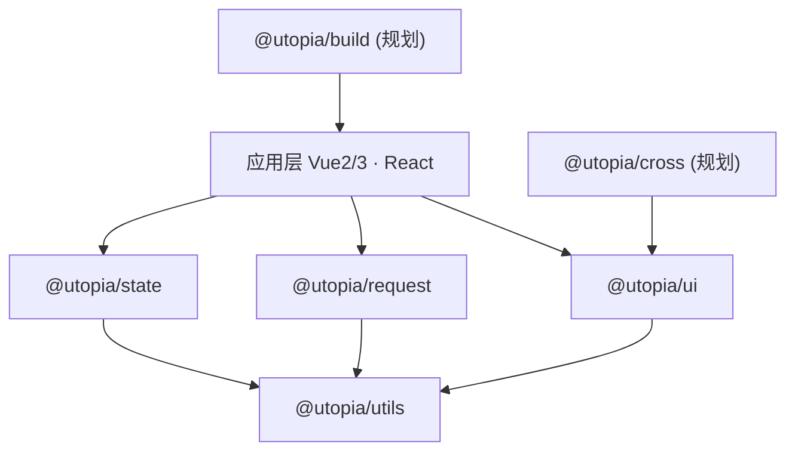

# Frontend Utopia

> **Utopia：告别前端的碎片化时代，把所有的拉，全变成夯。**

一套**零依赖、TypeScript 原生、Windows 7 可跑**的超融合前端框架。不引入任何原生 C++ 模块，不绑定任何构建器，浏览器端与 Node 端共用同一套 ESM 源码。

---

## 为什么要有 Utopia

| 生态现状（拉） | Utopia 的答案（夯） |
| --- | --- |
| Vuex 概念多、Redux 样板多 | `createState` 一个函数，Proxy 直接读写即提交，内建时间旅行 |
| Axios 包大、Fetch 无拦截器、SWR 功能少 | 原生 Fetch 封装：拦截器 + 自动取消 + 进度 + SWR 缓存引擎 |
| AntD 包大难覆盖、Vant 做 PC 难 | 无感组件原语 + CSS Variables 一键换肤，不需要 `!important` |
| Lodash 体积大、Day.js 时区麻烦 | 手写防抖/节流/深拷贝/去重 + 原生 `Intl` 日期，体积缩 90% |
| 各端差异靠条件编译 | 统一 API 代理层，按运行时自动降级 |
| Vite 生态不兼容、Webpack 慢 | esbuild-wasm 优先 + Webpack 5 兼容模式（规划中） |

## 架构总览

```text
                          ┌──────────────────────────────────────────┐
                          │            应用层 (Vue2/3 · React)        │
                          └───────────────┬──────────────────────────┘
                                          │ 只依赖 @utopia/* 的 ESM 入口
   ┌──────────────────────────────────────┼──────────────────────────────────────┐
   │                                      │                                      │
   ▼                                      ▼                                      ▼
┌──────────────────┐          ┌──────────────────────┐          ┌──────────────────────┐
│   @utopia/state  │          │   @utopia/request    │          │     @utopia/ui       │
│  Proxy 状态机     │◄────────►│  fetch + XHR 双传输   │          │  组件原语 + 主题引擎   │
│  · setState      │  读取    │  · 拦截器链           │          │  · button/input/…    │
│  · batch         │  状态    │  · AbortController    │          │  · table/toast       │
│  · subscribe     │          │  · 进度 / 重试        │          │  · applyTheme()      │
│  · timeTravel    │          │  · SWR 缓存 + 乐观更新│          │  · CSS Variables     │
│  · bindReact     │          └──────────┬───────────┘          └──────────┬───────────┘
│  · bindVue       │                     │                                 │
└────────┬─────────┘                     │                                 │
         │                               │                                 │
         └───────────────┬───────────────┴─────────────┬───────────────────┘
                         ▼                             ▼
              ┌────────────────────┐        ┌──────────────────────┐
              │   @utopia/utils    │        │  @utopia/cross (规划) │
              │ debounce/throttle  │        │ H5 / 小程序 / RN 代理  │
              │ deepClone / unique │        │ utopia.ui.toast(...)  │
              │ Intl 日期格式化     │        └──────────┬───────────┘
              └────────────────────┘                   │
                         │                             │
                         ▼                             ▼
              ┌────────────────────────────────────────────────────┐
              │              @utopia/build (规划)                   │
              │   esbuild-wasm 优先 · Webpack 5 兼容模式 · Win7 安全  │
              └────────────────────────────────────────────────────┘
```



**分层原则**：上层只依赖下层的公开 ESM 入口；包内不 import 彼此的实现细节，`@utopia/state`、`@utopia/utils` 等可单独安装使用（零运行时依赖、`sideEffects: false`）。

## 包一览

| 包 | 状态 | 说明 |
| --- | --- | --- |
| `@utopia/utils` | ✅ | 防抖 / 节流 / 深拷贝 / 去重 / 类型判断 / `Intl` 日期 |
| `@utopia/state` | ✅ | `createState` Proxy 状态机、订阅切片、批量提交、时间旅行、React/Vue 绑定 |
| `@utopia/request` | ✅ | 拦截器、自动取消、超时、重试、上传/下载进度、SWR 缓存与乐观更新 |
| `@utopia/ui` | ✅ | `h()` hyperscript、按钮/输入/开关/表格/toast 原语、主题换肤引擎 |
| `@utopia/cross` | 🚧 | 跨端抹平层（H5 / 小程序 / RN） |
| `@utopia/build` | 🚧 | esbuild-wasm + Webpack 5 双模式构建脚本 |

## 快速开始

```bash
npm install            # 仅装 typescript 一个 devDependency
npm run build          # tsc -b，产出各包 dist/
npm test               # 构建 + 编译测试 + 运行自研零依赖测试核
```

```ts
// 1) 状态：一个函数终结样板
import { createState } from '@utopia/state';
const store = createState({ count: 0 }, { maxHistory: 100 });
store.state.count++;                        // 直接改即提交
store.setState({ count: 10 });              // patch
store.batch(() => { store.state.count++; }); // 合并为一次提交
store.timeTravel.undo();                    // DevTools 时间旅行

// 2) 请求：拦截器 + 取消 + SWR
import { createHttp } from '@utopia/request';
const api = createHttp({ baseURL: 'https://api.example.com' });
api.interceptors.request.use(cfg => {
  cfg.headers['x-token'] = 'utopia';
  return cfg;
});
const user = await api.swr('/user/1', undefined, { staleTime: 5000 });
await user.mutate({ name: 'DSH' }, { optimistic: true }); // 乐观更新
api.cancel('/user/1');                                    // 成组取消

// 3) UI：原语 + 换肤
import { button, input, table, toast, applyTheme, createTheme } from '@utopia/ui';
applyTheme(createTheme('dark', { '--u-radius-md': '10px' }));
document.body.append(
  button({ text: '保存', variant: 'primary', onClick: save }),
  table({
    columns: [{ key: 'name', title: '名称', sortable: true }],
    rows: [{ name: 'Utopia' }],
    emptyText: '空空如也'
  })
);
toast('保存成功', { type: 'success' });

// 4) 工具：日期只靠 Intl
import { formatDate, debounce, deepClone } from '@utopia/utils';
formatDate(Date.now(), 'YYYY-MM-DD HH:mm:ss', { timeZone: 'Asia/Shanghai' });
```

## 设计要点

### state：一个 `createState` 打穿三件事

- **读写即提交**：根代理上的任意写操作都生成 `ChangeRecord`（含 `path` / `op` / `prev`），`version` 单调递增，`useSyncExternalStore` 直接消费。
- **选择器切片**：`select(selector, equalityFn)` 只在切片变化时通知，避免全量重渲染。
- **时间旅行**：每次提交保存快照（`maxHistory` 可配，`timeTravel: false` 省内存），`undo/redo/jumpTo` 回放后对象身份不变、订阅者无需重绑。
- **框架无关**：`bindReact(React)` / `bindVue(Vue)` 注入实例，不硬依赖；Vue 2.6+ 走 `observable`，Vue 3 走 `reactive`。

### request：拦截器链就是数组

```text
config ──▶ request 拦截器（后注册先执行）──▶ dispatchRequest ──▶ response 拦截器 ──▶ Promise
                                                   │
                                      retries + 1 次尝试 · 5xx 才重试
                                      AbortController · cancelTag 成组取消
                                      transport: auto/fetch/xhr（需要上传进度自动降级 XHR）
```

- **取消语义与 Axios 一致**：`isCancel` / `isTimeout`，错误统一为 `UtopiaRequestError`。
- **取消一定生效**：控制器在 `request()` 中同步登记，`get()` 之后立刻 `cancel(tag)` 也能命中；传输层与 `signal` 赛跑，即使底层 fetch 不监听 signal（测试替身 / 老运行时）也会正确 reject。
- **5xx 与 4xx 分离**：5xx 视为服务端故障，抛错并进入重试；4xx 属于业务响应，交由调用方按 `ok`/`status` 判断。
- **SWR**：`staleTime` 内直接复用缓存，过期先给 stale 再后台重验证，并发同 key 请求去重；`mutate` 支持乐观更新，网络返回后自动覆盖。
- **进度**：下载经 `body.getReader()` 流式回调，上传仅 XHR 支持（`transport: 'auto'` 自动判定）。

### ui：原语而不是组件库

- `h(tag, attrs, ...children)`：类名支持字符串/对象/嵌套数组，`style`、`dataset`、`on*` 事件、`ref` 统一处理。
- 组件只消费 CSS Variables（`--u-color-*`、`--u-radius-*`、`--u-space-*`），主题 = 一组 token；`applyTheme(theme, scope)` 可把主题作用到任意子树，实现局部换肤。
- 内置 `light` / `dark` / `glass` 三套皮肤，`glass` 用 `backdrop-filter` 做液态玻璃。
- 测试环境用 `scripts/wg-dom.ts` 这个极简 DOM 替身（`classList` 与 `class` 属性双向同步），组件逻辑在无浏览器环境下可验证。

### utils：能靠标准库就不引第三方

`deepClone` 保留原型链与 `Symbol` 键、`WeakMap` 处理循环引用；`formatDate` 完全基于 `Intl.DateTimeFormat#formatToParts`，`mm/ss` 等 token 由框架自己补零，绕开部分运行时 `2-digit` 不补零的实现差异。

## 测试

```bash
npm test
# 通过 62 / 62
```

- 自研零依赖测试核 `scripts/utest.ts`：`test/expect` 断言集（`toBe`/`toEqual`/`toThrow`/`toHaveLength`/`toBeGreaterThan(OrEqual)`…），不依赖 Jest/Vitest。
- 测试编译到 `dist-test/`，由 `scripts/test.mjs` 逐个 `import` 后统一 `runAll()`。
- 覆盖：状态机与时间旅行、React/Vue 适配器、拦截器/取消/超时/重试/进度/SWR、UI 组件与主题、日期时区、防抖节流、深拷贝循环引用。

## Windows 7 兼容红线

| 约束 | 做法 |
| --- | --- |
| 禁止原生 C++ 模块 | 仅 **1** 个 devDependency：`typescript` |
| 禁止重型编译工具 | 构建期只用 `tsc`；`@utopia/build` 规划用 `esbuild-wasm` |
| Node 版本 | `engines.node >= 14`，产物 `target: ES2019` |
| 无 `import.meta`/顶层 await | 全包纯 ESM + 普通函数，老运行时可直接加载 |
| 测试不依赖浏览器 | 自带 DOM 替身，CI 在 Ubuntu / Windows 双平台跑 Node 16/18/20 |

## 目录结构

```text
dsh-frontend-utopia/
├── packages/
│   ├── utils/    # @utopia/utils
│   ├── state/    # @utopia/state
│   ├── request/  # @utopia/request
│   └── ui/       # @utopia/ui
├── scripts/      # utest.ts 测试核 · test.mjs 运行器 · wg-dom.ts DOM 替身 · bundle/serve 脚本
├── tsconfig*.json
└── package.json  # workspaces: packages/*
```

## Roadmap

- [x] 四个核心包（utils / state / request / ui）与零依赖测试体系
- [ ] `@utopia/cross`：H5 / 小程序 / RN 统一代理层（`utopia.ui.toast` 等）
- [ ] `@utopia/build`：esbuild-wasm 优先、Webpack 5 兼容模式、Win7 一键构建
- [ ] DevTools 面板（时间旅行时间轴 + SWR 缓存观察器）
- [ ] 发布到 npm（`@utopia/*`，MIT）

## License

MIT © 2026 DSH Frontend Utopia Contributors
